# Beta and CAPM

[](https://github.com/Dhirajdas18/beta-capm/actions/workflows/ci.yml)
[](https://dhirajdas18.github.io/beta-capm/)

How much each NIFTY 50 stock moves with the market, how sure we can be of it, whether that exposure is
paid for, and how to hedge it: CAPM regression with honest standard errors, measurement choices, beta
forecasts, up and down betas, the security market line, futures hedging and price-based factors, on NSE
data.

**Live beta calculator: [dhirajdas18.github.io/beta-capm](https://dhirajdas18.github.io/beta-capm/)**.
Pick a stock, a window and daily or weekly returns: the page fits the CAPM regression in your browser and
shows beta and alpha with plain and Newey-West ranges, R², the scatter with its fitted line, beta through
time, and how much NIFTY to sell to hedge a holding. Rebuilt weekly from fresh prices.

## Features

- [x] CAPM regression for today's NIFTY 50: alpha, beta, R², Newey-West standard errors, multiple-testing check; live calculator tested against Python through Node
- [x] Measuring beta: daily, weekly and monthly; ETF against index; Dimson lags; robust regression; market and Dimson options in the calculator
- [x] Beta through time and forecasts: rolling, EWMA, Blume, Vasicek and Kalman, scored out of sample; EWMA line and Blume forecast in the calculator
- [x] Up and down betas, crash betas and whether asymmetry repeats; up/down row in the calculator
- [x] Does beta pay: Fama-MacBeth, beta-sorted portfolios, betting against beta and a long-only low-beta portfolio after costs; two dashboard sections
- [ ] Hedging with NIFTY futures out of sample, after F&O costs
- [ ] Beyond one factor: momentum, low volatility and sectors from prices

## Findings

### 1. Betas ran from 0.44 to 1.81 and the market explained a median 25% of daily moves; 6 of 49 alphas looked significant, about what luck gives, and none survived a multiple-testing correction

<a href="docs/img/capm_betas.png"><picture><source media="(prefers-reduced-motion: reduce)" srcset="docs/img/capm_betas.png"></picture></a>

The CAPM regression: each stock's daily return above cash (6.5% a year, over the calendar days between
closes) on the NIFTY ETF's, from 23 November 2021 to 23 November 2026, for the 49 of today's NIFTY 50
with prices on at least 95% of those days. Beta is the slope (how far the stock moves per 1% of NIFTY),
alpha the intercept (the average return the market doesn't explain, annualised by calendar time), R² the
share of the stock's daily variance the market accounts for. Standard errors come two ways: plain OLS,
which assumes each day's error is independent, and Newey-West (5 lags), which allows errors that
cluster in time and change in size.

- **Betas:** median 1.02. Lowest Cipla 0.44, Dr Reddy's 0.56, Sun Pharma 0.57; highest Shriram Finance
  1.56, Adani Ports 1.62, Adani Enterprises 1.81.
- **Honest ranges are wider:** Newey-West standard errors for beta were a median 28% wider than plain
  OLS (up to 2.05 times). For alpha the two were about the same (median ratio 0.97).
- **The market explains a minority:** median R² 0.25 (Cipla 0.06, highest 0.49); three quarters of a
  typical stock's daily variance is its own.

<table><tr>
<td><a href="docs/img/capm_scatter.png"><picture><source media="(prefers-reduced-motion: reduce)" srcset="docs/img/capm_scatter.png">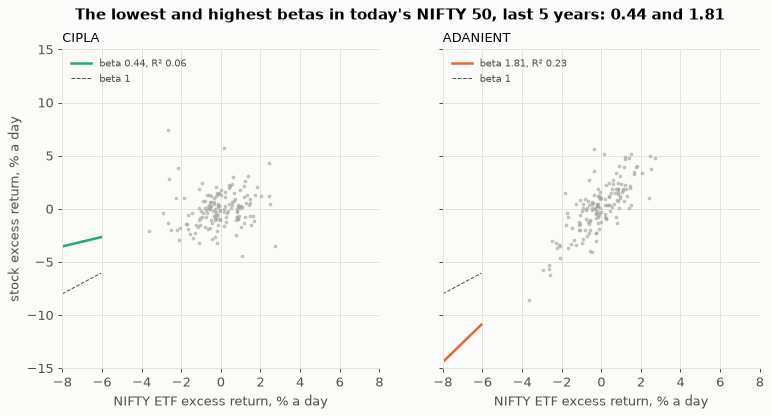</picture></a></td>
<td><a href="docs/img/capm_alphas.png"><picture><source media="(prefers-reduced-motion: reduce)" srcset="docs/img/capm_alphas.png">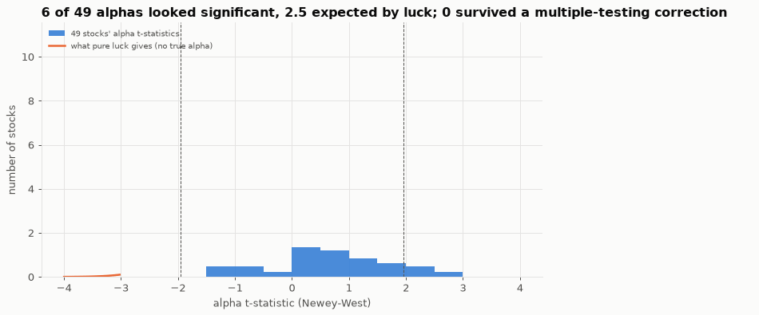</picture></a></td>
</tr></table>

- **Alpha is mostly noise (right):** 6 alphas had a Newey-West p-value below 0.05 (BSE, BEL, M&M,
  Coal India, Bajaj Auto, Bharti Airtel, all positive), against 2.5 expected by luck among 49. None passed
  a Benjamini-Hochberg false-discovery-rate test at 5%, or a Bonferroni test.
- **Survivors:** 80% of the alphas were positive (average +8.0% a year). These are today's NIFTY members;
  stocks that dropped out of the index in the period are missing from the list.

### 2. Which market you regress on mattered more than how: daily betas against the NIFTY ETF averaged 7% higher than against the index, while frequency, lags and robust weights moved them by 0.04 or less

<a href="docs/img/meas_market.png"><picture><source media="(prefers-reduced-motion: reduce)" srcset="docs/img/meas_market.png">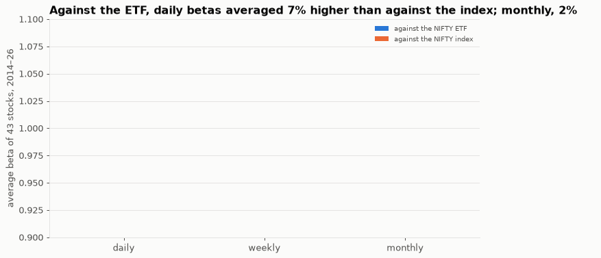</picture></a>

The 43 stocks with prices every day from January 2014 to November 2026 (3,181 days), regressed on two
versions of the market: the NIFTY ETF (dividends included, the price you can trade) and the NIFTY index
(price only), with daily, weekly and monthly returns above cash.

- **The ETF gives higher daily betas:** 1.052 on average against 0.979 for the index (+7.4%); weekly
  +4.3%, monthly +1.6%. The ETF's daily returns were 9% less volatile than the index's and correlated 0.97
  with them; weekly 4% less volatile (0.99), monthly 2% (1.00). Beta is a stock's covariance with the market
  divided by the market's variance: against the ETF the variance was 17% lower and the stocks'
  covariances 11% lower on average, which nets to the 7% higher betas (0.891 / 0.831 = 1.07).

<table><tr>
<td><a href="docs/img/meas_freq.png"><picture><source media="(prefers-reduced-motion: reduce)" srcset="docs/img/meas_freq.png">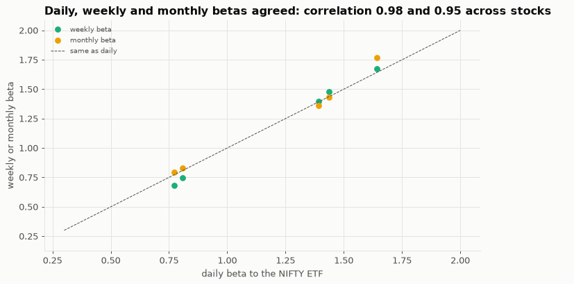</picture></a></td>
<td><a href="docs/img/meas_robust.png"><picture><source media="(prefers-reduced-motion: reduce)" srcset="docs/img/meas_robust.png">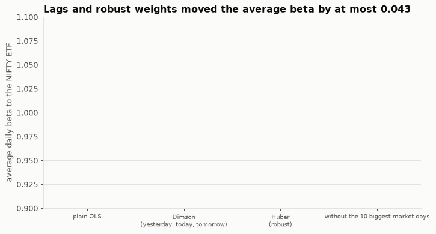</picture></a></td>
</tr></table>

- **Frequency (left):** against the ETF, weekly betas differed from daily by −0.011 on average (per-stock
  spread 0.061, from −0.115 to +0.121) and monthly by −0.009 (spread 0.117). Across stocks the daily betas
  correlated 0.98 with the weekly ones and 0.95 with the monthly ones.
- **Late prices (right):** the Dimson regression adds the slopes on the market's previous and next day.
  On average they were −0.038 and +0.018, so the summed beta (1.033) was a little below the plain one
  (1.052); the largest single change was Shriram Finance's, 0.20.
- **Extreme days (right):** Huber robust regression, which down-weights days with large surprises, gave
  1.009 on average (largest change: Adani Enterprises, 0.12); dropping the 10 biggest market days, 1.045.

### 3. Shrinking beta toward 1 forecast next year's beta best; for next month's hedge, every method was within 0.5% of the plain 1-year beta

<a href="docs/img/fc_score.png"><picture><source media="(prefers-reduced-motion: reduce)" srcset="docs/img/fc_score.png">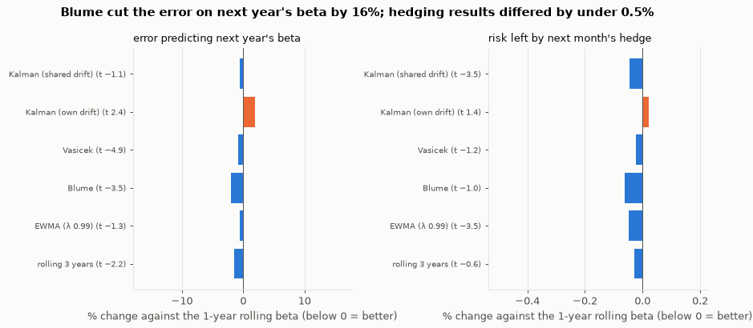</picture></a>

At each month end from January 2014 to October 2026 (154 months, 43 stocks, beta to the NIFTY index),
seven forecasts were made from data up to that day only, then scored two ways: squared error against the
beta realised over the next 250 days (142 months have a full year ahead), and the variance left in the
next month after selling beta × the holding of NIFTY. t-statistics compare each month's score with the
1-year rolling beta's (Newey-West: 12 lags for the overlapping years, 2 for months).

- **Next year's beta (left):** Blume's fixed rule, 0.67 × the 1-year beta + 0.33 (constants from Blume's
  1971 US study, not fitted here), cut the error by 16% (t −3.5). The 3-year rolling beta cut it by 12%
  (t −2.2) and Vasicek's shrinkage toward the average stock by 6% (t −5.2: small but steady).
- **The Kalman filter** (a beta that drifts a little each day) depends on one setting, how fast beta may
  drift. Fitted on 2011–13 for each stock, it raised the error by 16% (t 2.3): 5 of the 43 stocks got a
  drift above 10⁻³ from three years of data. One shared setting (the median of those fits, also from
  2011–13) cut the error by 4% (t −1.1).
- **Next month's hedge (right):** the hedged variance moved by at most 0.5% across methods. Over a month,
  the stock's own risk swamps small differences in the hedge ratio.

<a href="docs/img/fc_paths.png"><picture><source media="(prefers-reduced-motion: reduce)" srcset="docs/img/fc_paths.png">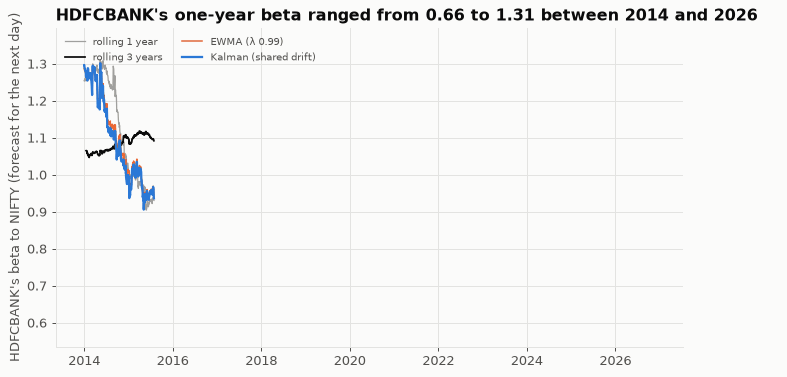</picture></a>

### 4. On average stocks fell harder with NIFTY than they rose with it (down beta 1.02 against up beta 0.93), but which stocks did so barely repeated from one period to the next

<a href="docs/img/asym_updown.png"><picture><source media="(prefers-reduced-motion: reduce)" srcset="docs/img/asym_updown.png">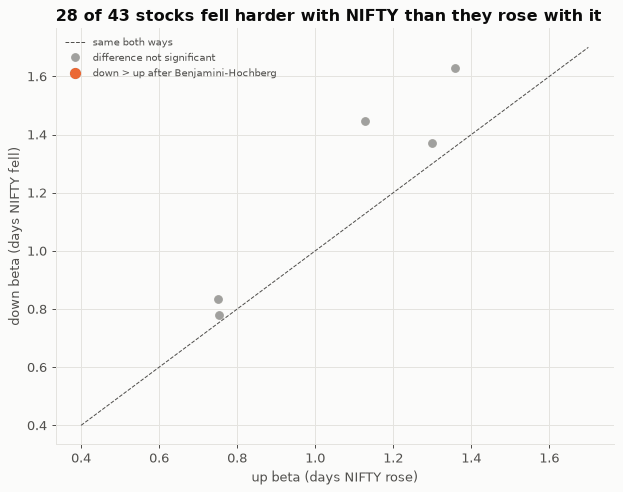</picture></a>

One regression per stock, daily returns above cash against the NIFTY index, January 2014 to November 2026
(43 stocks, 3,180 days), with one slope for days NIFTY rose and another for days it fell (shared intercept,
Newey-West t for the difference).

- **Down beta was higher for 28 of 43 stocks;** averages 0.93 up, 1.02 down. 7 stocks had a significant
  difference (p < 0.05), all with down > up, against 2.1 expected by luck; 3 survived Benjamini-Hochberg:
  Tech Mahindra (0.60 up, 0.95 down), NTPC and Apollo Hospitals. None had a significant up > down.
- **An equal-weight portfolio** of the 43: up 0.93, down 1.02 (t 4.6), and down > up in both 2014–19
  (0.95, 1.06) and 2020–26 (0.92, 1.01).
- **Crash beta,** the slope on NIFTY's worst 5% of days (159 days, falls of 1.5% or more), averaged 0.995
  against 0.979 for the plain beta, and correlated 0.83 with it across stocks.

<table><tr>
<td><a href="docs/img/asym_persist.png"><picture><source media="(prefers-reduced-motion: reduce)" srcset="docs/img/asym_persist.png">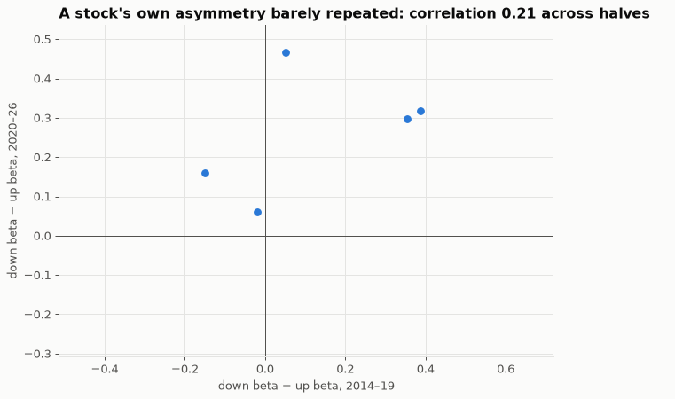</picture></a></td>
<td><a href="docs/img/asym_halves.png"><picture><source media="(prefers-reduced-motion: reduce)" srcset="docs/img/asym_halves.png">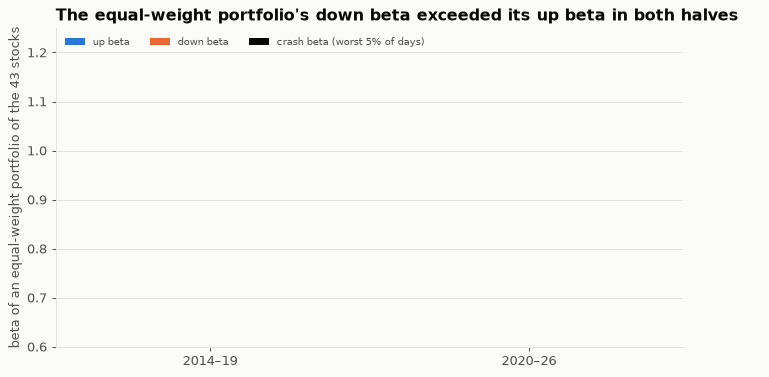</picture></a></td>
</tr></table>

- **Does a stock's asymmetry repeat? (left)** Down − up in 2014–19 correlated only 0.21 with down − up in
  2020–26 across stocks. The average gap held (+0.11, then +0.09); which stocks had it mostly did not.

### 5. Higher beta didn't earn more: the reward per unit of beta was −1.2% a year (t −0.2), though 15 years can't rule out CAPM's +5.8% either

<a href="docs/img/price_sml.png"><picture><source media="(prefers-reduced-motion: reduce)" srcset="docs/img/price_sml.png">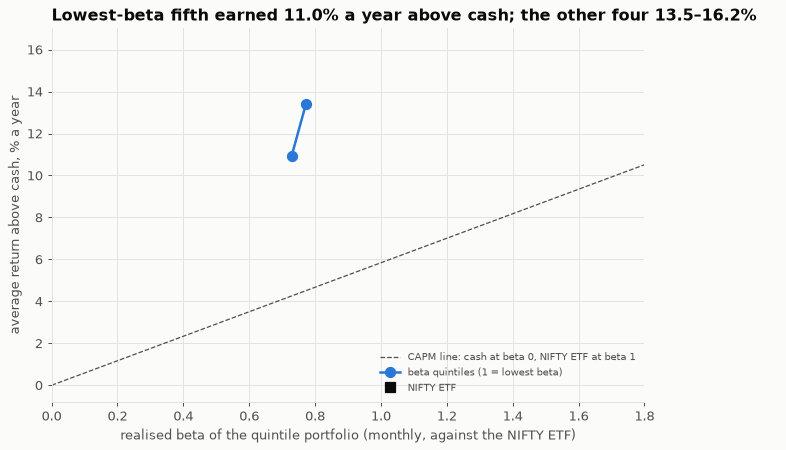</picture></a>

Each month from February 2012 to October 2026 (177 months, 43 to 50 stocks), each stock's beta was the
Blume-shrunk past-year beta to the NIFTY index, known at the start of the month; returns are the next
month's, above cash. The market premium is the NIFTY ETF's (dividends included): 5.8% a year.

- **Fama-MacBeth:** regressing each month's returns on the betas gave an average slope of −1.2% a year
  (Newey-West t −0.17). CAPM predicts the slope equals the market premium; the gap, −7.0% a year, has
  t −1.13. Neither "beta pays nothing" nor "beta pays as CAPM says" can be rejected with 177 months.
- **Beta fifths (chart above):** realised betas ran from 0.73 to 1.50; returns above cash were 11.0%,
  16.0%, 16.2%, 13.5% and 15.1% a year from lowest to highest. Every fifth sits far above the CAPM line,
  and the Fama-MacBeth intercept was 15.1% a year (t 2.5): these are today's NIFTY 50 members looking
  back, so survivorship lifts every group. Compare the groups with each other, not with the line.

<a href="docs/img/price_bab.png"><picture><source media="(prefers-reduced-motion: reduce)" srcset="docs/img/price_bab.png">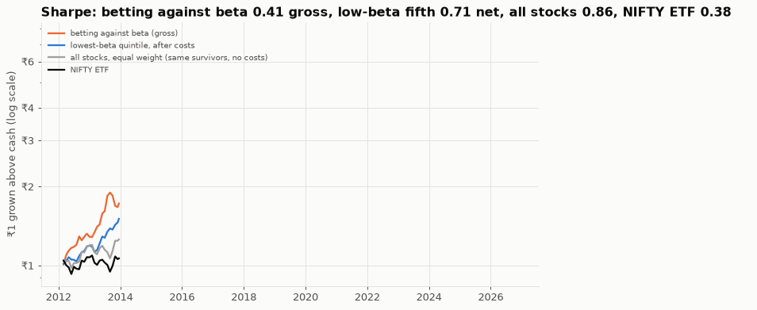</picture></a>

- **Betting against beta** (long the low-beta half and short the high-beta half, each scaled to beta 1):
  6.9% a year above cash before costs, volatility 16.8%, Sharpe 0.41; alpha against the ETF 7.2% a year,
  t 1.65, market beta −0.05. It traded 34% of its position a month, so costs above 1.8% per rupee traded
  would erase the alpha; shorting needs stock futures, whose costs aren't modelled here.
- **Long-only lowest-beta fifth:** 10.6% a year above cash after Zerodha delivery costs (0.38% a year),
  Sharpe 0.71. All stocks equally weighted, the same survivors with no costs, made Sharpe 0.86; the
  low-beta fifth trailed it by 3.8% a year (t −1.3) with beta 0.73 against 1.04.

## Quick start

```bash
uv sync
uv run python scripts/fetch_data.py         # Yahoo Finance -> data/prices.parquet, data/global.parquet
uv run bc report capm                       # also: measure, forecast, asym, pricing; charts -> out/
uv run python scripts/build_site.py         # dashboard -> site/index.html
uv run pytest
```

## Design

- `src/bc/capm.py`: excess returns over calendar days, OLS with plain and Newey-West standard errors,
  Benjamini-Hochberg, and a per-stock CAPM table annualised by calendar time.
- `src/bc/measure.py`: weekly and monthly returns, Dimson beta and Huber robust beta.
- `src/bc/forecast.py`: rolling, EWMA, Vasicek and Kalman beta forecasts, each from past days only.
- `src/bc/asym.py`: up and down betas with a Newey-West test of the difference, and crash beta.
- `src/bc/pricing.py`: Fama-MacBeth, beta-sorted portfolios and betting against beta.
- `src/bc/beta.js`, `calculator.html`: the same regression, excess returns, weekly returns, Dimson beta and
  rolling beta in the browser, against the NIFTY ETF or index; a test runs them through Node against Python. Five years of returns are embedded as
  integers (0.001% units).
- `src/bc/data.py`: Yahoo prices for today's NIFTY 50, the index and two ETFs since 2007, with known errors
  repaired from `docs/data/yahoo_fixes.csv` (scanned for one-day spike-and-reverse prints); the S&P 500
  total-return index and USD/INR in a separate table.
- `src/bc/reports.py`: README findings, reproducible with `bc report <topic>`.
- `src/bc/site.py`, `page.html`: the dashboard, one static page; no server.

MIT licence.
