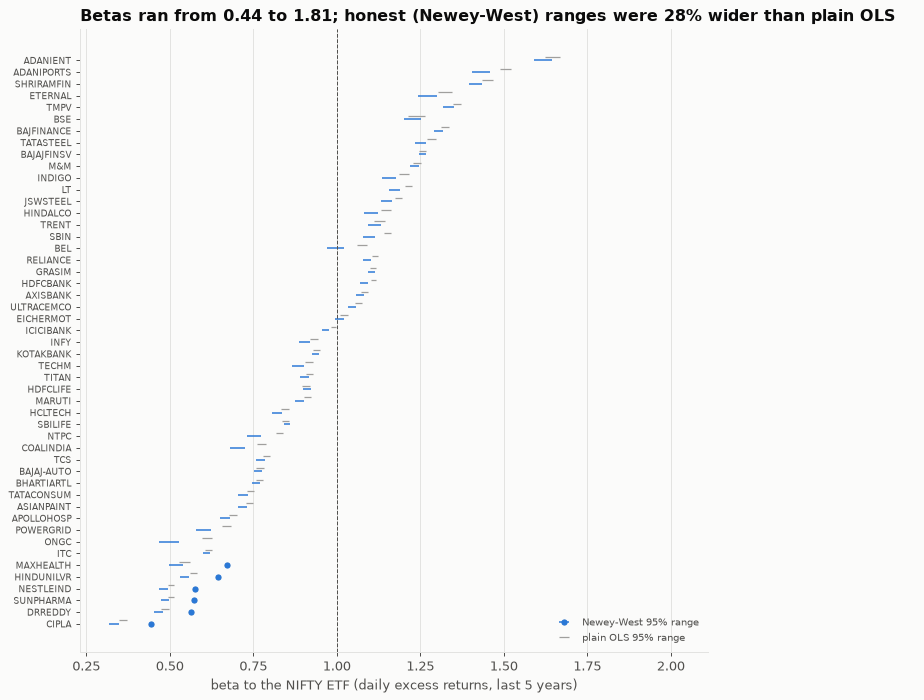

# Beta and CAPM

[](https://github.com/Dhirajdas18/beta-capm/actions/workflows/ci.yml)
[](https://dhirajdas18.github.io/beta-capm/)

How much each NIFTY 50 stock moves with the market, how sure we can be of it, whether that exposure is
paid for, and how to hedge it: CAPM regression with honest standard errors, measurement choices, beta
forecasts, up and down betas, the security market line, futures hedging and price-based factors, on NSE
data.

**Live beta calculator: [dhirajdas18.github.io/beta-capm](https://dhirajdas18.github.io/beta-capm/)**.
Pick a stock, a window and daily or weekly returns: the page fits the CAPM regression in your browser and
shows beta and alpha with plain and Newey-West ranges, R², the scatter with its fitted line, beta through
time, and how much NIFTY to sell to hedge a holding. Rebuilt weekly from fresh prices.

## Features

- [x] CAPM regression for today's NIFTY 50: alpha, beta, R², Newey-West standard errors, multiple-testing check; live calculator tested against Python through Node
- [ ] Measuring beta: daily, weekly and monthly; Dimson lags; robust regression
- [ ] Beta through time and forecasting it: rolling, EWMA, Vasicek, Kalman
- [ ] Up and down beta; betas in crashes
- [ ] Does beta pay? Security market line, Fama-MacBeth, betting against beta
- [ ] Hedging with NIFTY futures out of sample, after F&O costs
- [ ] Beyond one factor: momentum, low volatility and sectors from prices

## Findings

### 1. Betas ran from 0.44 to 1.81 and the market explained a median 25% of daily moves; 6 of 49 alphas looked significant, about what luck gives, and none survived a multiple-testing correction

<a href="docs/img/capm_betas.png"><picture><source media="(prefers-reduced-motion: reduce)" srcset="docs/img/capm_betas.png"></picture></a>

The CAPM regression: each stock's daily return above cash (6.5% a year, over the calendar days between
closes) on the NIFTY ETF's, from 23 November 2021 to 23 November 2026, for the 49 of today's NIFTY 50
with prices on at least 95% of those days. Beta is the slope (how far the stock moves per 1% of NIFTY),
alpha the intercept (the average return the market doesn't explain, annualised by calendar time), R² the
share of the stock's daily variance the market accounts for. Standard errors come two ways: plain OLS,
which assumes each day's error is independent, and Newey-West (5 lags), which allows errors that
cluster in time and change in size.

- **Betas:** median 1.02. Lowest Cipla 0.44, Dr Reddy's 0.56, Sun Pharma 0.57; highest Shriram Finance
  1.56, Adani Ports 1.62, Adani Enterprises 1.81.
- **Honest ranges are wider:** Newey-West standard errors for beta were a median 28% wider than plain
  OLS (up to 2.05 times). For alpha the two were about the same (median ratio 0.97).
- **The market explains a minority:** median R² 0.25 (Cipla 0.06, highest 0.49); three quarters of a
  typical stock's daily variance is its own.

<table><tr>
<td><a href="docs/img/capm_scatter.png"><picture><source media="(prefers-reduced-motion: reduce)" srcset="docs/img/capm_scatter.png"></picture></a></td>
<td><a href="docs/img/capm_alphas.png"><picture><source media="(prefers-reduced-motion: reduce)" srcset="docs/img/capm_alphas.png"></picture></a></td>
</tr></table>

- **Alpha is mostly noise (right):** 6 alphas had a Newey-West p-value below 0.05 (BSE, BEL, M&M,
  Coal India, Bajaj Auto, Bharti Airtel, all positive), against 2.5 expected by luck among 49. None passed
  a Benjamini-Hochberg false-discovery-rate test at 5%, or a Bonferroni test.
- **Survivors:** 80% of the alphas were positive (average +8.0% a year). These are today's NIFTY members;
  stocks that dropped out of the index in the period are missing from the list.

## Quick start

```bash
uv sync
uv run python scripts/fetch_data.py         # Yahoo Finance -> data/prices.parquet, data/global.parquet
uv run bc report capm                       # charts -> out/
uv run python scripts/build_site.py         # dashboard -> site/index.html
uv run pytest
```

## Design

- `src/bc/capm.py`: excess returns over calendar days, OLS with plain and Newey-West standard errors,
  Benjamini-Hochberg, and a per-stock CAPM table annualised by calendar time.
- `src/bc/beta.js`, `calculator.html`: the same regression, excess returns, weekly returns and rolling
  beta in the browser; a test runs them through Node against Python. Five years of returns are embedded as
  integers (0.001% units).
- `src/bc/data.py`: Yahoo prices for today's NIFTY 50, the index and two ETFs since 2007, with known errors
  repaired from `docs/data/yahoo_fixes.csv` (scanned for one-day spike-and-reverse prints); the S&P 500
  total-return index and USD/INR in a separate table.
- `src/bc/reports.py`: README findings, reproducible with `bc report <topic>`.
- `src/bc/site.py`, `page.html`: the dashboard, one static page; no server.

MIT licence.
